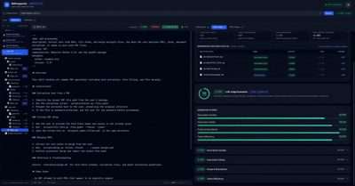

# Skill Inspector

[](https://github.com/neo7337/skill_inspector/actions/workflows/ci.yml) [](LICENSE) 

A web-based validation studio and CLI companion for [agentskills.io](https://agentskills.io) format `SKILL.md` skill packages. Combines static structural validation, on-disk reference resolution, multi-tier context token economics, LLM-as-a-Judge behavioral evaluation, interactive auto-repair, synthetic red-teaming scenario generation, and execution trajectory profiling.

---



---

## Table of Contents

- [Features](#features)
- [Quick Start](#quick-start)
  - [Prerequisites](#prerequisites)
  - [Install and Run](#install-and-run)
- [CLI Installation and Usage](#cli-installation-and-usage)
  - [Install CLI](#install-cli)
  - [CLI Configuration](#cli-configuration)
  - [CLI Commands](#cli-commands)
- [Backend API](#backend-api)
  - [Endpoints](#endpoints)
  - [Run Backend Tests](#run-backend-tests)
- [LLM Provider Setup](#llm-provider-setup)
  - [OpenAI](#openai)
  - [Anthropic](#anthropic)
  - [Ollama (local, no API key)](#ollama-local-no-api-key)
- [Static Validation Rules](#static-validation-rules)
- [LLM Evaluation Dimensions](#llm-evaluation-dimensions)
- [Project Structure & Page Tree](#project-structure--page-tree)
- [Contributing and Security](#contributing-and-security)
- [License](#license)

---

## Features

- **Live Split-Pane Studio** — Independent left (Editor) and right (Report Panels) scrolling panes with fixed header, status beacon, and token stats bar for distraction-free editing.
- **Skill Package Resolution Engine** — Attach on-disk package roots (`--base-dir`) to discover, resolve, and audit referenced scripts (`scripts/`), documentation (`references/`), and assets (`assets/`) with safe path-traversal prevention.
- **Multi-Tier Context Token Economics** — Live visual breakdown and gauge tracking Catalog footprint, Activation Body token count, and On-Demand Reference peak context footprint.
- **Slide-Over Reference File Drawer** — Inspect referenced file contents, line counts, sizes, and token footprints directly inside the UI with syntax highlighting.
- **Static Analysis & Reference Rules** — Enforces all agentskills.io spec rules plus package reference validation (`references.file-exists`, `references.path-traversal`, `references.not-empty`, and `references.peak-token-budget`).
- **Interactive "Diff & Repair" Studio** — Visual unified diffs and one-click ESLint-style `--fix` actions with CLI repair for frontmatter schemas, naming conventions, and AI instruction refactoring.
- **LLM-as-Judge with Package Grounding** — Behavioral evaluation across Description Quality, Instruction Clarity, Scope & Boundaries, and Token Efficiency, grounded in referenced file summaries.
- **Synthetic Scenario & Edge-Case Generator** — Automatically synthesizes 10–16 realistic scenarios across Happy Path, Adversarial, Tool Failure Modes, and Scope Boundaries, exportable to Pytest, JSON, and Markdown.
- **Trajectory & Step-Economy Profiler** — Analyzes agent execution traces against baselines, flagging redundant file reads, search loops, error ping-pongs, and context bloat with interactive timeline visualization.
- **Claude Code / Plugin Linting Mode** — Toggle `--mode claude-code` (CLI) or the linting-mode switch (UI) to accept Claude Code-specific frontmatter fields and list-style `allowed-tools`.
- **Project Scanner** — Open a whole project directory, discover every skill in the file tree and resolve its references.
- **Multi-Provider Support** — OpenAI, Anthropic Claude, and Ollama (local models, no API key needed).
- **Skill Inspector CLI** — Full-featured command-line suite with `validate` (with rich package tables), `fix`, `profile`, and `generate-tests`.

---

## Quick Start

### Prerequisites

- Python 3.11+
- Node.js 18+
- (Optional) [Ollama](https://ollama.ai) for local LLM evaluation

### Install and Run

```bash
# Install all dependencies (backend virtualenv + frontend npm modules)

make install

# Configure frontend environment (optional / defaults)
cat <<EOF > frontend/.env.local
VITE_API_URL=http://localhost:8000
VITE_ENABLE_SYNTHETIC_TESTS=1
VITE_ENABLE_TRAJECTORY_PROFILER=1
EOF

# Start backend + frontend (two terminals, or run separately)
make backend   # terminal 1 — http://localhost:8000
make frontend  # terminal 2 — http://localhost:5173
```

Or run both in one command (background):
```bash
make dev
```

Or run both using Docker:
```bash
# Start services in background
docker compose up -d

# View logs (frontend, backend, or both)
docker compose logs -f frontend
docker compose logs -f backend
docker compose logs -f

# Stop services
docker compose down
```

---

## CLI Installation and Usage

### Install CLI

Install the latest version via the automated installer:
```bash
curl -sSL https://raw.githubusercontent.com/neo7337/skill_inspector/main/install/install.sh | bash
```

Or install a specific version (e.g., v0.0.7):
```bash
curl -sSL https://raw.githubusercontent.com/neo7337/skill_inspector/main/install/install.sh | bash -s -- v0.0.7
```

Alternatively, install from a local checkout:
```bash
pip install -e backend
```

The installer is a short script — review [`install/install.sh`](install/install.sh) before piping it to `bash`.

### CLI Configuration

The CLI supports persistent user configuration stored at `~/.skill-inspector/config.json`. When configuration values are set, you no longer need to repeatedly pass provider, model, API key, base directory, or baseline options on every command.

#### View & Initialize Configuration

```bash
# View active configuration and resolved values
skill-inspector config

# Display the configuration file path
skill-inspector config --path

# Initialize a default ~/.skill-inspector/config.json file
skill-inspector config --init
```

#### Configuration Schema (`~/.skill-inspector/config.json`)

```json
{
  "llm": {
    "default_provider": "ollama",
    "default_model": "llama3.1:latest",
    "api_keys": {
      "openai": "sk-...",
      "anthropic": "sk-ant-..."
    },
    "ollama_base_url": "http://localhost:11434"
  },
  "validation": {
    "base_dir": null
  },
  "profiler": {
    "default_baseline_steps": 5
  },
  "scenarios": {
    "default_format": "json",
    "default_count": 12
  }
}
```

#### Configuration Resolution Hierarchy

When executing commands, parameters resolve in the following order:
1. **Explicit CLI Flags** (e.g. `--provider anthropic --model claude-3-5-haiku-20241022`)
2. **User Configuration** (`~/.skill-inspector/config.json`)
3. **Environment Variables** (e.g. `OPENAI_API_KEY`, `ANTHROPIC_API_KEY`, `OLLAMA_BASE_URL`)
4. **Built-in Defaults** (e.g. `count=12`, `format=json`)

### CLI Commands

The companion CLI provides terminal validation, package inspection, auto-repair, trajectory profiling, test generation, and configuration management:

```bash
# Validate SKILL.md with static structural checks
skill-inspector validate path/to/SKILL.md

# Validate with full package resolution & reference auditing
skill-inspector validate path/to/SKILL.md --base-dir path/to/skill-package

# Validate with Claude Code / plugin fields accepted
skill-inspector validate path/to/SKILL.md --mode claude-code

# Run static + LLM-as-a-Judge (uses provider & model from ~/.skill-inspector/config.json)
skill-inspector validate path/to/SKILL.md --llm

# Explicitly override provider or model on demand
skill-inspector validate path/to/SKILL.md --llm --provider openai --model gpt-4o

# Auto-fix frontmatter schema errors & show unified diff
skill-inspector fix path/to/SKILL.md --dry-run
skill-inspector fix path/to/SKILL.md --apply

# AI-assisted instruction refactoring (uses config.json defaults or explicit flags)
skill-inspector fix path/to/SKILL.md --llm --apply

# Profile execution trajectory trace against baseline steps (or configured default)
skill-inspector profile path/to/trace.json
skill-inspector profile path/to/trace.json --baseline 3

# Generate synthetic test scenario matrix & export to Pytest (defaults to config.json count & format)
skill-inspector generate-tests path/to/SKILL.md
skill-inspector generate-tests path/to/SKILL.md --format pytest --output tests/test_skill.py
```

---

## Backend API

FastAPI server runs at `http://localhost:8000`. Interactive OpenAPI documentation is available at `http://localhost:8000/docs`.

### Endpoints

| Method | Path | Description |
|--------|------|-------------|
| GET | `/health` | Health check & service connectivity status |
| GET | `/skill/file` | Read the full content of a referenced file inside a package (path-traversal safe) |
| POST | `/project/scan` | Walk a project directory and return a file tree with detected skills |
| POST | `/project/resolve` | Resolve a selected skill's references within the project |
| POST | `/skill/package` | Inspect & resolve package directory, audit referenced files, and calculate context token economics |
| POST | `/validate/static` | Run static structural validation and reference checks (supports optional `base_dir` and `mode`) |
| POST | `/validate/llm` | Run LLM-as-Judge behavioral evaluation with package context |
| POST | `/repair/plan` | Generate deterministic repair plan and unified diff |
| POST | `/repair/apply` | Apply deterministic frontmatter & schema repairs |
| POST | `/repair/refactor-llm` | AI-assisted instruction refactoring |
| POST | `/scenarios/generate` | Synthesize edge-case test scenario suite |
| POST | `/scenarios/export` | Export test scenarios to Pytest, JSON, or Markdown |
| POST | `/profiler/trajectory` | Profile agent execution trace for redundancy, loops, bloat, and reference access audit |

### Run Backend Tests

```bash
make test
# or
cd backend && PYTHONPATH=. .venv/bin/pytest tests/ -v
```

The suite covers parser, package resolution engine, static validator, repair engine, trajectory profiler, scenario generator, CLI commands, and API endpoints.

---

## LLM Provider Setup

### OpenAI

1. Get an API key from [platform.openai.com](https://platform.openai.com)
2. In the UI: select **OpenAI**, enter your key in the API Key field
3. Recommended model: `gpt-4o` or `gpt-4o-mini`

### Anthropic

1. Get an API key from [console.anthropic.com](https://console.anthropic.com)
2. In the UI: select **Anthropic**, enter your key
3. Recommended model: `claude-3-5-haiku-20241022` or `claude-3-5-sonnet-20241022`

### Ollama (local, no API key)

1. Install Ollama: `brew install ollama` or [download from ollama.ai](https://ollama.ai)
2. Pull a model: `ollama pull llama3`
3. Ollama runs automatically on `http://localhost:11434`
4. In the UI: select **Ollama (local)**, enter `llama3` as the model

> Note: Local models on CPU can take 15–60 seconds per evaluation.

---

## Static Validation Rules

All rules from the [agentskills.io specification](https://agentskills.io/specification) plus package reference integrity:

| Field / Dimension | Rule ID | Description | Severity |
|-------------------|---------|-------------|----------|
| `name` | `name.required` | Required frontmatter field | FAIL |
| `name` | `name.max-length` | Max 64 characters | FAIL |
| `name` | `name.format` | Lowercase alphanumeric + hyphens only | FAIL |
| `name` | `name.no-leading-trailing-hyphens` | No leading or trailing hyphens | FAIL |
| `name` | `name.no-consecutive-hyphens` | No consecutive hyphens (`--`) | FAIL |
| `description` | `description.required` | Required frontmatter field | FAIL |
| `description` | `description.max-length` | Max 1024 characters | FAIL |
| `description` | `description.when-to-use` | Should explicitly mention "when to use" / activation cues | WARN |
| `compatibility` | `compatibility.max-length` | Max 500 characters if present | FAIL |
| `metadata` | `metadata.type` | Must be a string→string key-value mapping | WARN |
| `allowed-tools` | `allowed-tools.type` | Must be a string if defined | FAIL |
| Body | `body.non-empty` | Body instructions must not be empty | FAIL |
| Body | `body.max-lines` | Recommended < 500 lines (prompt bloat prevention) | WARN |
| Body | `body.max-tokens` | Recommended < 5,000 tokens for body instructions | WARN |
| Frontmatter | `frontmatter.unknown-fields` | Unrecognized fields not defined in agentskills.io spec | WARN |
| References | `references.file-exists` | On-disk referenced file must exist within package root | FAIL |
| References | `references.path-traversal` | Path traversal (`../` or leading `/`) forbidden | FAIL |
| References | `references.not-empty` | Referenced file must contain content (non-zero bytes) | WARN |
| References | `references.peak-token-budget` | Recommended peak context footprint < 10,000 tokens | WARN |

---

## LLM Evaluation Dimensions

| Dimension | What it Checks |
|-----------|----------------|
| **Description Quality** | Does it state both WHAT the skill does AND WHEN to activate it? |
| **Instruction Clarity** | Are steps unambiguous, structured, and resilient for agentic execution? |
| **Scope & Boundaries** | Does it clearly define negative boundaries and what the skill should NOT do? |
| **Token Efficiency** | Is the body concise, or bloated with redundant text and repetitive instructions? |

Scores range from 0–100 per dimension: **Pass ≥ 75**, **Warn ≥ 50**, **Fail < 50**.

---

## Project Structure & Page Tree

```
skill_inspector/
├── README.md, CHANGELOG.md, LICENSE
├── CONTRIBUTING.md, SECURITY.md, CODE_OF_CONDUCT.md
├── Makefile                  # dev, test, install, build, clean
├── docker-compose.yml        # FastAPI + Vite containers
├── .github/                  # CI workflow, issue/PR templates, Dependabot
├── install/install.sh        # curl|bash CLI installer (pipx)
├── assets/                   # README demo media
├── backend/
│   ├── README.md             # backend-specific docs
│   ├── pyproject.toml        # package metadata; version read from app/__init__.py
│   ├── requirements.txt
│   ├── app/
│   │   ├── main.py           # FastAPI endpoints
│   │   ├── cli.py            # Typer CLI
│   │   ├── config.py         # ~/.skill-inspector/config.json
│   │   ├── parser.py         # SKILL.md frontmatter parser
│   │   ├── package.py        # package resolution & token economics
│   │   ├── project.py        # project scan & resolve
│   │   ├── validators/       # static rules + LLM judge
│   │   ├── repair/           # deterministic and LLM-assisted fixes
│   │   ├── scenarios/        # synthetic scenario generation/export
│   │   └── profiler/         # trajectory profiler
│   └── tests/                # pytest suite
├── frontend/                 # React + Vite + Tailwind studio
│   └── src/                  # App.tsx, api.ts, components/, hooks/, utils/
└── samples/                  # valid, broken and Claude Code example skills, sample trace
```

---

## Contributing and Security

Contributions are welcome — see [CONTRIBUTING.md](CONTRIBUTING.md) and the [Code of Conduct](CODE_OF_CONDUCT.md). Report vulnerabilities privately as described in [SECURITY.md](SECURITY.md).

---

## License

Licensed under the [MIT License](LICENSE).